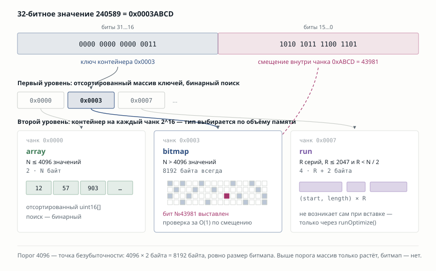
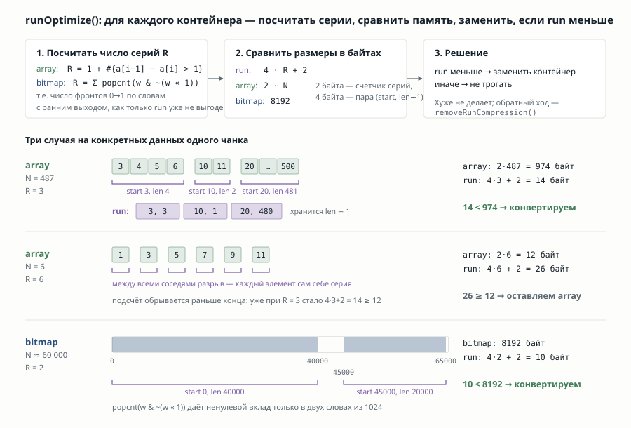

+++
title = 'Roaring bitmaps in ClickHouse'
date = 2026-09-07T10:00:00+04:00
tags = [ "Roaring bitmaps", "ClickHouse", "algorithms" ]

draft = true
+++

Не так давно мне довелось попробовать работать с ClickHouse. В частности, с такой ее фичей, как Roaring Bitmaps. Остался от данного опыта под приятным впечатлением, и, в тоже время, заинтеревовался, за счет чего roaring bitmaps работают наслолько быстро. Ведь простая локальность данных и параллелизм - это то, что можно применить на обычных битмапах. Решил разобрать, как же реализована эта структура данных в ClickHouse и заодно проверить ее по сравнению хотя бы с наивной реализацией bitmap.

### Для чего нужен roaring bitmaps?

Почему бы просто не хранить в bitmaps/arrays?

При хранении множества в bitmap нам заранее нужно выделить большой объем памяти под все потенциально возможные значения. При наличии миллионов значений мы получим, что каждое такое множество должно иметь размер в мегабайты. Если это будут разреженные данные, то большая часть этих данных будет пустой.

При хранении множества в array нам нужно обращаться к элементу через бинарный поиск. Так же для пересечения 2-х массивов (при мерже) нужно линейно пройтись по ним в общем случае.

Зачастую, мы заранее не можем сказать какой характер данных поступит на вход и, соответственно, нельзя выбрать одну из 2-х этих структур для оптимальной работы. Для таких случаев и придумана такая гибридная структура данных как roaring bitmap.

## Описание структуры данных roaring bitmaps

roaring bitmaps хранит 32-х битные значения.

Основная идея данной структуры данных - поделить весь диапазон нзначений на небольшие "корзинки", каждая из которых оптимизирована по характеру данных, которые в них содержатся. 

Для большого набора последовательных значений используется такая оптимизация, как **run-контейнеры**, которая дает существенный прирост в производительности на данных, в которых есть последовательные цепочки. Небольшой прирост в производительности дает векторизация - по моим замерам до 1.5 раз на операцию `And`.

Поверх roaring bitmaps навешивают операции rank и select со своими оптимизациями. Например, для select изпользуется кеш в виде массива префиксных сумм.

При создании структуры выделяется таблица ключей контейнеров. В ней в качестве индекса используются верхние биты занчения (64К значений). Таким образом, в корзинке, которая по этому ключу доступна, так же воможно хранить не более 64К элементов из из нижних 16 бит переданного 32-х битного числа.  

При добавлении/удалении/проверке на принадлежность необходимо выполнить поиск значения. При поиске значения мы сначала ищем в таблице ключей по верхним битам числа. Затем, в зависимости от типа контейнера или выполняем 

### Run-container оптимизация

На этапе `run optimize`, выполняется замена bitmap и array на run-контейнеры.

Run-container - это RLE, массив интервалов, каждый элемент которого содержит начальный индекс и длину интервала.

Выгоды от такого способа представления множества довольно очевидны - при достаточно плотном наборе чилел в контейнере, мы получим оптимизацию по памяти. При этом, поскольку количество интервалов невелико, то и бинарный поиск будет состоять из всего лишь несколких проверок. Поэтому даже переход от bitmap контейнера к run контейнеру не даст заметной просадки в производительности.

Run-container не берется сразу при вставке элементов. Данный шаг (замену "стандартных" контейнеров на run-container) нужно делать периодически в бекграунде и перед сериализацией.

Для замены bitmap и array на run-container нужно сравнить размер текущего контейнера и полученного контейнера с интервалами. Для этого нужно сначала посчитать R - число последовательно идущих серий значений. Каждый интервал содержит 2 числа - начальный индекс и длину этого интервала. Поэтому, размер контейнера с интервалами будет `4*R`  - 2 16-ти битных числа. Размер же изначального контейнера будет равен `2*N`. Если `4*R` меньше, чем `2*N`, то конвертируем в run контейнер.

Для подсчета `R` в bitmap можно использовать popcnt. Но может быть несколько подряд идущих ноликов, а нам нужно посчитать только те нолики, которые идут перед серией из единиц. Другими словами - число серий равно числу позиций, где серия начинается, то есть где бит равен 1, а предыдущий (младший) бит равен 0. Для этого мы считаем сумму по каждому слову в bitmap контейнере `popcnt(w & ~(w<<1))`.

## Объединение и пересечение roaring bitmaps

Для объединения/пересечения roaring bitmaps нам нужно 

## Реализация в ClickHouse

## Benchmark

Для бенчмарка возьмем несколько реализаций
1. Только bitmaps & arrays
2. Включены run-containers

Для сериализации и Rank/Select операции хранится копия значений рядом с битмапом, с которой выполняется сравнение.

В данных бенчмарках не рассматривается влияние векторых операций, поскольку 
1. они не являются основными в данной структуре
2. я не являюсь хоть сколько-нибудь сведующим в данном вопросе

